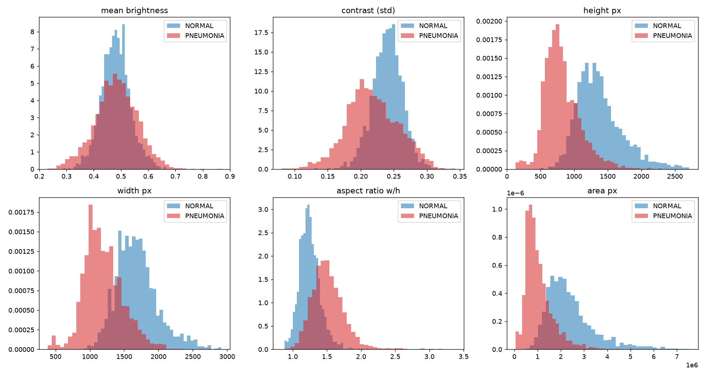
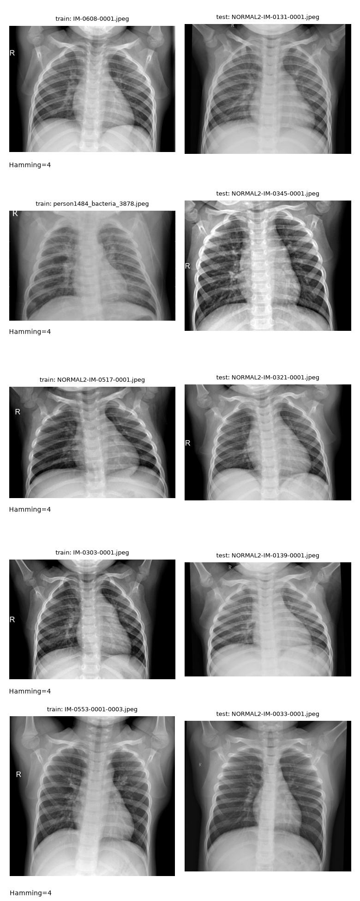
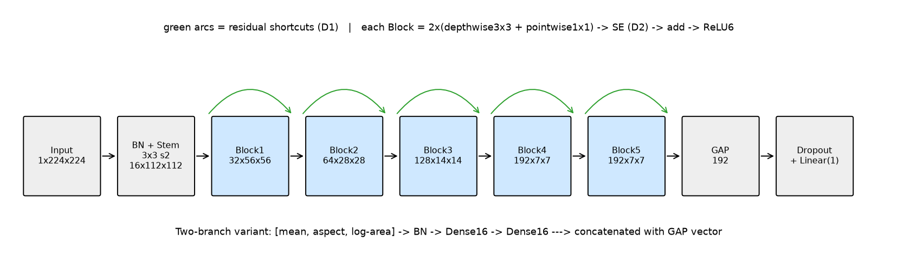
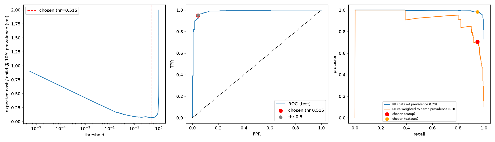
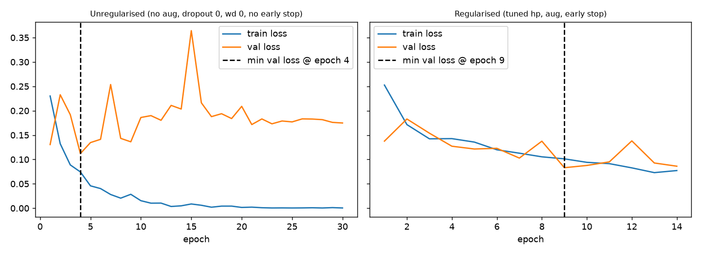
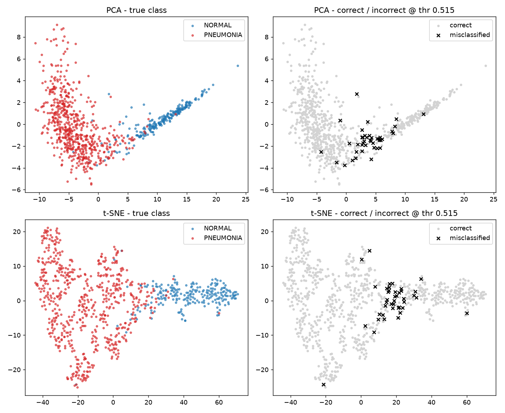
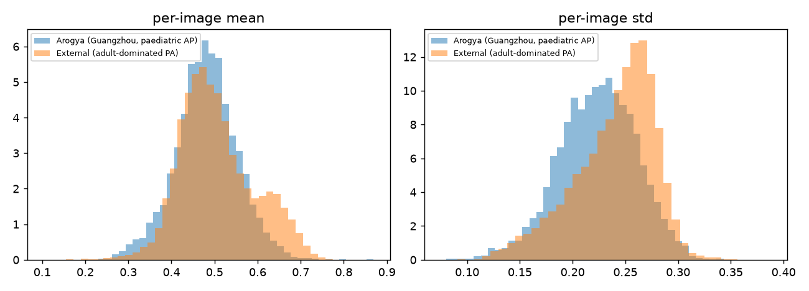

# MediScan Audit — Technical Report (target 5–7 pages once you add your prose; every table below is pulled in from results/)

## 0. Summary & the wrong instruction
WRITE ~10 lines: instruction 2 ("99% accuracy") is wrong; show the camp-prevalence arithmetic below.
# Per 1,000 children at the camp (100 sick, 900 healthy); cost = 20 per missed case + 1 per false alarm

| scenario                                                  |   sick_missed |   healthy_flagged | accuracy   | sensitivity   | specificity   | PPV    | NPV    |   cost |
|:----------------------------------------------------------|--------------:|------------------:|:-----------|:--------------|:--------------|:-------|:-------|-------:|
| Always say NORMAL (does nothing)                          |         100   |               0   | 90.0%      | 0.0%          | 100.0%        | n/a    | 90.0%  | 2000   |
| Pilot model: ~70% of healthy flagged                      |           0   |             630   | 37.0%      | 100.0%        | 30.0%         | 13.7%  | 100.0% |  630   |
| Hypothetical '99% accuracy', all 10 errors = missed cases |          10   |               0   | 99.0%      | 90.0%         | 100.0%        | 100.0% | 98.9%  |  200   |
| Hypothetical '99% accuracy', all 10 errors = false alarms |           0   |              10   | 99.0%      | 100.0%        | 98.9%         | 90.9%  | 100.0% |   10   |
| ArogyaNet @ cost-optimal threshold 0.515 (locked test)    |           5.1 |              39.8 | 95.5%      | 94.9%         | 95.6%         | 70.4%  | 99.4%  |  141.3 |

Take-away: accuracy cannot distinguish the 2nd 99%-model (10 false alarms) from the 1st (10 missed sick children, cost 200). A do-nothing tool already scores 90%. The target must be a sensitivity floor (e.g. >= 95%) at an acceptable false-alarm rate, verified with confidence intervals on a patient-disjoint test set, plus PPV/NPV at 9:1 prevalence.

## 1. Audit of Rohit's data (Part 1, tasks 1–3)
# Audit numbers (auto-generated by audit.py)

## 1. Inventory (original Kaggle split)
| orig_split   |   NORMAL |   PNEUMONIA |   total |
|:-------------|---------:|------------:|--------:|
| test         |      234 |         390 |     624 |
| train        |     1341 |        3875 |    5216 |
| val          |        8 |           8 |      16 |
| ALL          |     1583 |        4273 |    5856 |

Image modes: {'L': 5573, 'RGB': 283}.  Pixel-identical-channel greyscale: 5856 / 5856  (100.0%).

### Per-class size / brightness summary
|               |         NORMAL |        PNEUMONIA |
|:--------------|---------------:|-----------------:|
| h_mean        | 1378.65        |    819.554       |
| h_median      | 1323           |    776           |
| h_std         |  343.018       |    270.862       |
| w_mean        | 1686.38        |   1195.07        |
| w_median      | 1654           |   1160           |
| w_std         |  305.316       |    285.145       |
| aspect_mean   |    1.249       |      1.515       |
| aspect_median |    1.235       |      1.49        |
| aspect_std    |    0.152       |      0.247       |
| area_mean     |    2.41748e+06 |      1.04897e+06 |
| area_median   |    2.17728e+06 | 897146           |
| area_std      |    1.06158e+06 | 605822           |
| mean_mean     |    0.481       |      0.482       |
| mean_median   |    0.48        |      0.482       |
| mean_std      |    0.053       |      0.078       |
| std_mean      |    0.24        |      0.217       |
| std_median    |    0.241       |      0.215       |
| std_std       |    0.023       |      0.039       |

### Can ONE metadata number separate the classes? (AUC 0.5 = no; far from 0.5 = shortcut)
| feature   |   single_feature_AUC |   KS_stat |
|:----------|---------------------:|----------:|
| mean      |                0.508 |     0.109 |
| std       |                0.302 |     0.383 |
| h         |                0.085 |     0.694 |
| w         |                0.111 |     0.638 |
| aspect    |                0.84  |     0.545 |
| area      |                0.09  |     0.685 |

## 2. Duplicates / leakage
Exact byte-duplicates: 30 groups, 32 redundant files; 0 groups span more than one original split.

Near-duplicate pairs (pHash Hamming <= 4/64): 239 total; 218 within a split, 21 across splits.

| pair_type     |   pairs |   same_patient |   mean_corr |
|:--------------|--------:|---------------:|------------:|
| test vs train |      21 |              0 |       0.876 |
| within test   |       8 |              5 |       0.965 |
| within train  |     210 |             28 |       0.905 |

**Train->test leakage:** 15 of 624 test images (2.4%) have a train near-duplicate (Hamming <= 4).

**Patient overlap (from file names):** 264 patient IDs appear in BOTH train and test (416 test images belong to a patient also in train).

Worst five train/test pairs: `figures/audit_worst5_train_test_pairs.png` [('IM-0608-0001.jpeg', 'NORMAL2-IM-0131-0001.jpeg', 4), ('person1484_bacteria_3878.jpeg', 'NORMAL2-IM-0345-0001.jpeg', 4), ('NORMAL2-IM-0517-0001.jpeg', 'NORMAL2-IM-0321-0001.jpeg', 4), ('IM-0303-0001.jpeg', 'NORMAL2-IM-0139-0001.jpeg', 4), ('IM-0553-0001-0003.jpeg', 'NORMAL2-IM-0033-0001.jpeg', 4)]

## 3. Validation set
Observed 16/16 = 100% -> exact (Clopper-Pearson) 95% CI = [0.794, 1.000].  The val set could be hiding a true accuracy as low as 79.4%.

Rohit's 98.4% on 624 test images = ~10 errors; 95% CI [0.971, 0.992] (statistical noise only - leakage is on top of this).

 
# Split design (auto-generated by split.py)
|              |   NORMAL |   PNEUMONIA |   pct_pneumonia |
|:-------------|---------:|------------:|----------------:|
| ('pool', 0)  |      272 |         732 |            72.9 |
| ('pool', 1)  |      272 |         732 |            72.9 |
| ('pool', 2)  |      271 |         733 |            73   |
| ('pool', 3)  |      271 |         733 |            73   |
| ('pool', 4)  |      271 |         732 |            73   |
| ('test', -1) |      226 |         611 |            73   |

Groups = 2778 (patient IDs merged with near-duplicate clusters). No group appears in two splits (asserted).

## Why a locked test set + k-fold, and not one alone
* **Locked patient-grouped hold-out test (~14%)**: touched only for final reporting; gives one unbiased number.
* **5 stratified, patient-grouped folds on the remaining pool**: fold 0 acts as the validation set for model selection;
  all five give mean ± std for Part 2.
* **Rejected: a single train/val/test split only** - with ~800 validation images the estimate still carries sampling noise
  (CI width roughly ±3 pp at 90% accuracy), and every tuning decision overfits that one slice.
* **Rejected: k-fold only (no locked test)** - every image gets used for tuning at some point, so the reported CV score
  is optimistically biased by hyper-parameter and threshold selection.
* **Patient grouping** is essential: several X-rays per child exist (person123_bacteria_1/2/3), so image-level splitting
  lets the model recognise the child instead of the disease.
* Original Kaggle split pooled and re-split by patient: 1254 of 5856 images changed split.

## 2. Shortcut hunt and baselines (tasks 4–5)
# Shortcut hunt (trained on pool, evaluated on locked test)
| model                                           |   acc |   bal_acc |   recall |   specificity |   roc_auc |   pr_auc |
|:------------------------------------------------|------:|----------:|---------:|--------------:|----------:|---------:|
| majority class                                  | 0.73  |     0.5   |    1     |         0     |     0.5   |    0.73  |
| 16x16 pixels + LogReg                           | 0.925 |     0.901 |    0.953 |         0.85  |     0.975 |    0.991 |
| 16x16 pixels + RandForest                       | 0.912 |     0.871 |    0.959 |         0.783 |     0.968 |    0.987 |
| lung field masked (border only) + LogReg        | 0.888 |     0.844 |    0.939 |         0.748 |     0.923 |    0.959 |
| metadata only (mean, aspect, area) + LogReg     | 0.841 |     0.775 |    0.918 |         0.633 |     0.916 |    0.97  |
| metadata only (mean, aspect, area) + RandForest | 0.858 |     0.809 |    0.915 |         0.704 |     0.922 |    0.971 |

Test-set pneumonia share = 0.730. Chance balanced accuracy = 0.5, chance ROC-AUC = 0.5.
Read: if the crippled models are far above 0.5 balanced accuracy / AUC, brightness, framing or border information (not lung texture) already separates the classes.

# Baselines (train folds 1-4, validate fold 0, locked test)
| model          | split   |   acc |   bal_acc |   precision |   recall |   specificity |    f1 |   roc_auc |   pr_auc |
|:---------------|:--------|------:|----------:|------------:|---------:|--------------:|------:|----------:|---------:|
| majority class | val     | 0.729 |     0.5   |       0.729 |    1     |         0     | 0.843 |     0.5   |    0.729 |
| majority class | test    | 0.73  |     0.5   |       0.73  |    1     |         0     | 0.844 |     0.5   |    0.73  |
| HOG + LogReg   | val     | 0.943 |     0.929 |       0.962 |    0.96  |         0.897 | 0.961 |     0.988 |    0.995 |
| HOG + LogReg   | test    | 0.939 |     0.932 |       0.968 |    0.948 |         0.916 | 0.958 |     0.981 |    0.993 |
| LBP + LogReg   | val     | 0.934 |     0.909 |       0.946 |    0.964 |         0.853 | 0.955 |     0.977 |    0.991 |
| LBP + LogReg   | test    | 0.912 |     0.889 |       0.941 |    0.938 |         0.841 | 0.939 |     0.959 |    0.984 |

## 3. Models (tasks 6–9)
# ArogyaNet architecture (auto-generated by arch_report.py)

## ArogyaNet (image only) — total parameters: **242,319** (limit 2,000,000)

| layer | output shape (B,C,H,W) | params |
|---|---|---|
| norm | (2, 1, 224, 224) | 2 |
| stem | (2, 16, 112, 112) | 176 |
| block1 | (2, 32, 56, 56) | 3,060 |
| block2 | (2, 64, 28, 28) | 10,728 |
| block3 | (2, 128, 14, 14) | 39,888 |
| block4 | (2, 192, 7, 7) | 100,120 |
| block5 | (2, 192, 7, 7) | 88,152 |
| gap | (2, 192, 1, 1) | 0 |
| drop | (2, 192) | 0 |
| fc | (2, 1) | 193 |
| **total** | | **242,319** |

## no residual — total parameters: **206,159** (limit 2,000,000)

| layer | output shape (B,C,H,W) | params |
|---|---|---|
| norm | (2, 1, 224, 224) | 2 |
| stem | (2, 16, 112, 112) | 176 |
| block1 | (2, 32, 56, 56) | 2,484 |
| block2 | (2, 64, 28, 28) | 8,552 |
| block3 | (2, 128, 14, 14) | 31,440 |
| block4 | (2, 192, 7, 7) | 75,160 |
| block5 | (2, 192, 7, 7) | 88,152 |
| gap | (2, 192, 1, 1) | 0 |
| drop | (2, 192) | 0 |
| fc | (2, 1) | 193 |
| **total** | | **206,159** |

## no SE — total parameters: **217,827** (limit 2,000,000)

| layer | output shape (B,C,H,W) | params |
|---|---|---|
| norm | (2, 1, 224, 224) | 2 |
| stem | (2, 16, 112, 112) | 176 |
| block1 | (2, 32, 56, 56) | 2,768 |
| block2 | (2, 64, 28, 28) | 9,632 |
| block3 | (2, 128, 14, 14) | 35,648 |
| block4 | (2, 192, 7, 7) | 90,688 |
| block5 | (2, 192, 7, 7) | 78,720 |
| gap | (2, 192, 1, 1) | 0 |
| drop | (2, 192) | 0 |
| fc | (2, 1) | 193 |
| **total** | | **217,827** |

## two-branch (+metadata) — total parameters: **242,677** (limit 2,000,000)

| layer | output shape (B,C,H,W) | params |
|---|---|---|
| norm | (2, 1, 224, 224) | 2 |
| stem | (2, 16, 112, 112) | 176 |
| block1 | (2, 32, 56, 56) | 3,060 |
| block2 | (2, 64, 28, 28) | 10,728 |
| block3 | (2, 128, 14, 14) | 39,888 |
| block4 | (2, 192, 7, 7) | 100,120 |
| block5 | (2, 192, 7, 7) | 88,152 |
| gap | (2, 192, 1, 1) | 0 |
| meta | (2, 16) | 342 |
| drop | (2, 208) | 0 |
| fc | (2, 1) | 209 |
| **total** | | **242,677** |

Hypotheses (written before results): see hypotheses.md
# All runs, mean ± std over seeds (thresholds fixed at 0.5 here; threshold work is in threshold_cost.md)

| tag                   |   n_seeds |   params | val_roc_auc   | val_pr_auc    | val_bal_acc   | val_recall    | val_specificity   | test_roc_auc   | test_pr_auc   | test_bal_acc   | test_recall   | test_specificity   |
|:----------------------|----------:|---------:|:--------------|:--------------|:--------------|:--------------|:------------------|:---------------|:--------------|:---------------|:--------------|:-------------------|
| arogyanet             |         3 |   242319 | 0.993 ± 0.002 | 0.996 ± 0.002 | 0.966 ± 0.006 | 0.982 ± 0.004 | 0.950 ± 0.014     | 0.988 ± 0.001  | 0.996 ± 0.000 | 0.945 ± 0.006  | 0.954 ± 0.012 | 0.937 ± 0.003      |
| arogyanet_aug_naive   |         3 |   242319 | 0.992 ± 0.001 | 0.995 ± 0.002 | 0.958 ± 0.005 | 0.984 ± 0.005 | 0.933 ± 0.015     | 0.988 ± 0.002  | 0.996 ± 0.001 | 0.946 ± 0.004  | 0.959 ± 0.007 | 0.934 ± 0.012      |
| arogyanet_aug_none    |         3 |   242319 | 0.991 ± 0.000 | 0.996 ± 0.000 | 0.952 ± 0.003 | 0.982 ± 0.002 | 0.922 ± 0.008     | 0.982 ± 0.001  | 0.993 ± 0.001 | 0.934 ± 0.006  | 0.969 ± 0.003 | 0.900 ± 0.009      |
| arogyanet_meta        |         3 |   242677 | 0.994 ± 0.001 | 0.997 ± 0.001 | 0.964 ± 0.003 | 0.986 ± 0.001 | 0.941 ± 0.006     | 0.990 ± 0.001  | 0.996 ± 0.001 | 0.949 ± 0.007  | 0.965 ± 0.004 | 0.934 ± 0.018      |
| arogyanet_nores       |         3 |   206159 | 0.991 ± 0.001 | 0.995 ± 0.001 | 0.947 ± 0.015 | 0.970 ± 0.008 | 0.924 ± 0.021     | 0.985 ± 0.001  | 0.994 ± 0.000 | 0.932 ± 0.003  | 0.952 ± 0.003 | 0.913 ± 0.007      |
| arogyanet_nose        |         3 |   217827 | 0.992 ± 0.000 | 0.996 ± 0.001 | 0.959 ± 0.001 | 0.980 ± 0.003 | 0.938 ± 0.004     | 0.988 ± 0.001  | 0.996 ± 0.000 | 0.944 ± 0.006  | 0.954 ± 0.008 | 0.934 ± 0.004      |
| arogyanet_res96       |         3 |   242319 | 0.992 ± 0.001 | 0.997 ± 0.000 | 0.961 ± 0.003 | 0.982 ± 0.002 | 0.940 ± 0.004     | 0.985 ± 0.003  | 0.994 ± 0.001 | 0.934 ± 0.003  | 0.959 ± 0.006 | 0.909 ± 0.007      |
| arogyanet_tuned       |         3 |   242319 | 0.993 ± 0.001 | 0.996 ± 0.000 | 0.969 ± 0.004 | 0.981 ± 0.001 | 0.957 ± 0.009     | 0.989 ± 0.001  | 0.996 ± 0.000 | 0.953 ± 0.003  | 0.956 ± 0.005 | 0.950 ± 0.007      |
| arogyanet_tuned_clahe |         3 |   242319 | 0.994 ± 0.001 | 0.997 ± 0.000 | 0.963 ± 0.004 | 0.983 ± 0.005 | 0.942 ± 0.012     | 0.989 ± 0.001  | 0.996 ± 0.001 | 0.950 ± 0.003  | 0.968 ± 0.006 | 0.932 ± 0.011      |
| arogyanet_tuned_cw    |         3 |   242319 | 0.990 ± 0.003 | 0.995 ± 0.001 | 0.955 ± 0.013 | 0.970 ± 0.008 | 0.940 ± 0.019     | 0.984 ± 0.004  | 0.994 ± 0.001 | 0.933 ± 0.014  | 0.939 ± 0.005 | 0.928 ± 0.026      |
| curve_reg             |         1 |   242319 | 0.994 ± 0.000 | 0.997 ± 0.000 | 0.965 ± 0.000 | 0.981 ± 0.000 | 0.949 ± 0.000     | 0.985 ± 0.000  | 0.994 ± 0.000 | 0.932 ± 0.000  | 0.948 ± 0.000 | 0.916 ± 0.000      |
| curve_unreg           |         1 |   242319 | 0.989 ± 0.000 | 0.995 ± 0.000 | 0.934 ± 0.000 | 0.975 ± 0.000 | 0.893 ± 0.000     | 0.980 ± 0.000  | 0.988 ± 0.000 | 0.931 ± 0.000  | 0.967 ± 0.000 | 0.894 ± 0.000      |
| cv_fold0              |         1 |   242319 | 0.993 ± 0.000 | 0.997 ± 0.000 | 0.958 ± 0.000 | 0.975 ± 0.000 | 0.941 ± 0.000     | 0.985 ± 0.000  | 0.994 ± 0.000 | 0.927 ± 0.000  | 0.961 ± 0.000 | 0.894 ± 0.000      |
| cv_fold1              |         1 |   242319 | 0.993 ± 0.000 | 0.997 ± 0.000 | 0.962 ± 0.000 | 0.973 ± 0.000 | 0.952 ± 0.000     | 0.986 ± 0.000  | 0.994 ± 0.000 | 0.945 ± 0.000  | 0.971 ± 0.000 | 0.920 ± 0.000      |
| cv_fold2              |         1 |   242319 | 0.993 ± 0.000 | 0.997 ± 0.000 | 0.964 ± 0.000 | 0.980 ± 0.000 | 0.948 ± 0.000     | 0.986 ± 0.000  | 0.995 ± 0.000 | 0.942 ± 0.000  | 0.954 ± 0.000 | 0.929 ± 0.000      |
| cv_fold3              |         1 |   242319 | 0.992 ± 0.000 | 0.997 ± 0.000 | 0.961 ± 0.000 | 0.981 ± 0.000 | 0.941 ± 0.000     | 0.988 ± 0.000  | 0.995 ± 0.000 | 0.940 ± 0.000  | 0.972 ± 0.000 | 0.907 ± 0.000      |
| cv_fold4              |         1 |   242319 | 0.991 ± 0.000 | 0.991 ± 0.000 | 0.959 ± 0.000 | 0.985 ± 0.000 | 0.934 ± 0.000     | 0.988 ± 0.000  | 0.996 ± 0.000 | 0.940 ± 0.000  | 0.956 ± 0.000 | 0.925 ± 0.000      |
| mobilenetv3           |         3 |   927585 | 0.997 ± 0.001 | 0.999 ± 0.000 | 0.966 ± 0.009 | 0.987 ± 0.003 | 0.946 ± 0.020     | 0.994 ± 0.001  | 0.998 ± 0.000 | 0.962 ± 0.007  | 0.981 ± 0.011 | 0.944 ± 0.024      |
| resnet18              |         3 | 11177025 | 0.998 ± 0.001 | 0.999 ± 0.000 | 0.977 ± 0.003 | 0.991 ± 0.005 | 0.963 ± 0.010     | 0.995 ± 0.000  | 0.998 ± 0.000 | 0.968 ± 0.007  | 0.981 ± 0.001 | 0.954 ± 0.016      |

# Ablations (variant minus reference). Rule: a difference is 'INSIDE NOISE' if |Δ| < sqrt(std_ref² + std_var²).

| ablation                                          | split   | metric   |   reference |   variant |   delta | spread   | verdict      |
|:--------------------------------------------------|:--------|:---------|------------:|----------:|--------:|:---------|:-------------|
| D1 residual connections REMOVED                   | val     | roc_auc  |       0.993 |     0.991 |  -0.002 | ±0.002   | worse        |
| D1 residual connections REMOVED                   | val     | pr_auc   |       0.996 |     0.995 |  -0     | ±0.002   | INSIDE NOISE |
| D1 residual connections REMOVED                   | val     | bal_acc  |       0.966 |     0.947 |  -0.019 | ±0.016   | worse        |
| D1 residual connections REMOVED                   | test    | roc_auc  |       0.988 |     0.985 |  -0.004 | ±0.001   | worse        |
| D1 residual connections REMOVED                   | test    | pr_auc   |       0.996 |     0.994 |  -0.001 | ±0.001   | worse        |
| D1 residual connections REMOVED                   | test    | bal_acc  |       0.945 |     0.932 |  -0.013 | ±0.007   | worse        |
| D2 squeeze-excitation REMOVED                     | val     | roc_auc  |       0.993 |     0.992 |  -0.001 | ±0.002   | INSIDE NOISE |
| D2 squeeze-excitation REMOVED                     | val     | pr_auc   |       0.996 |     0.996 |   0     | ±0.002   | INSIDE NOISE |
| D2 squeeze-excitation REMOVED                     | val     | bal_acc  |       0.966 |     0.959 |  -0.007 | ±0.006   | worse        |
| D2 squeeze-excitation REMOVED                     | test    | roc_auc  |       0.988 |     0.988 |   0     | ±0.001   | INSIDE NOISE |
| D2 squeeze-excitation REMOVED                     | test    | pr_auc   |       0.996 |     0.996 |   0     | ±0.000   | INSIDE NOISE |
| D2 squeeze-excitation REMOVED                     | test    | bal_acc  |       0.945 |     0.944 |  -0.001 | ±0.009   | INSIDE NOISE |
| metadata branch ADDED (two-branch)                | val     | roc_auc  |       0.993 |     0.994 |   0.001 | ±0.002   | INSIDE NOISE |
| metadata branch ADDED (two-branch)                | val     | pr_auc   |       0.996 |     0.997 |   0.001 | ±0.002   | INSIDE NOISE |
| metadata branch ADDED (two-branch)                | val     | bal_acc  |       0.966 |     0.964 |  -0.002 | ±0.007   | INSIDE NOISE |
| metadata branch ADDED (two-branch)                | test    | roc_auc  |       0.988 |     0.99  |   0.002 | ±0.002   | INSIDE NOISE |
| metadata branch ADDED (two-branch)                | test    | pr_auc   |       0.996 |     0.996 |   0.001 | ±0.001   | INSIDE NOISE |
| metadata branch ADDED (two-branch)                | test    | bal_acc  |       0.945 |     0.949 |   0.004 | ±0.009   | INSIDE NOISE |
| input resolution 224 -> 96                        | val     | roc_auc  |       0.993 |     0.992 |  -0.001 | ±0.002   | INSIDE NOISE |
| input resolution 224 -> 96                        | val     | pr_auc   |       0.996 |     0.997 |   0.001 | ±0.002   | INSIDE NOISE |
| input resolution 224 -> 96                        | val     | bal_acc  |       0.966 |     0.961 |  -0.005 | ±0.007   | INSIDE NOISE |
| input resolution 224 -> 96                        | test    | roc_auc  |       0.988 |     0.985 |  -0.003 | ±0.003   | worse        |
| input resolution 224 -> 96                        | test    | pr_auc   |       0.996 |     0.994 |  -0.001 | ±0.001   | INSIDE NOISE |
| input resolution 224 -> 96                        | test    | bal_acc  |       0.945 |     0.934 |  -0.012 | ±0.006   | worse        |
| augmentation safe -> none                         | val     | roc_auc  |       0.993 |     0.991 |  -0.002 | ±0.002   | INSIDE NOISE |
| augmentation safe -> none                         | val     | pr_auc   |       0.996 |     0.996 |   0.001 | ±0.002   | INSIDE NOISE |
| augmentation safe -> none                         | val     | bal_acc  |       0.966 |     0.952 |  -0.014 | ±0.007   | worse        |
| augmentation safe -> none                         | test    | roc_auc  |       0.988 |     0.982 |  -0.006 | ±0.001   | worse        |
| augmentation safe -> none                         | test    | pr_auc   |       0.996 |     0.993 |  -0.003 | ±0.001   | worse        |
| augmentation safe -> none                         | test    | bal_acc  |       0.945 |     0.934 |  -0.011 | ±0.008   | worse        |
| augmentation safe -> naive (with horizontal flip) | val     | roc_auc  |       0.993 |     0.992 |  -0.001 | ±0.002   | INSIDE NOISE |
| augmentation safe -> naive (with horizontal flip) | val     | pr_auc   |       0.996 |     0.995 |  -0     | ±0.002   | INSIDE NOISE |
| augmentation safe -> naive (with horizontal flip) | val     | bal_acc  |       0.966 |     0.958 |  -0.008 | ±0.008   | INSIDE NOISE |
| augmentation safe -> naive (with horizontal flip) | test    | roc_auc  |       0.988 |     0.988 |   0     | ±0.002   | INSIDE NOISE |
| augmentation safe -> naive (with horizontal flip) | test    | pr_auc   |       0.996 |     0.996 |   0     | ±0.001   | INSIDE NOISE |
| augmentation safe -> naive (with horizontal flip) | test    | bal_acc  |       0.945 |     0.946 |   0.001 | ±0.007   | INSIDE NOISE |
| ResNet18 (pretrained) vs ArogyaNet                | val     | roc_auc  |       0.998 |     0.993 |  -0.005 | ±0.002   | worse        |
| ResNet18 (pretrained) vs ArogyaNet                | val     | pr_auc   |       0.999 |     0.996 |  -0.004 | ±0.002   | worse        |
| ResNet18 (pretrained) vs ArogyaNet                | val     | bal_acc  |       0.977 |     0.966 |  -0.011 | ±0.007   | worse        |
| ResNet18 (pretrained) vs ArogyaNet                | test    | roc_auc  |       0.995 |     0.988 |  -0.007 | ±0.001   | worse        |
| ResNet18 (pretrained) vs ArogyaNet                | test    | pr_auc   |       0.998 |     0.996 |  -0.003 | ±0.000   | worse        |
| ResNet18 (pretrained) vs ArogyaNet                | test    | bal_acc  |       0.968 |     0.945 |  -0.022 | ±0.009   | worse        |
| class weights (training-side treatment)           | val     | roc_auc  |       0.993 |     0.99  |  -0.003 | ±0.003   | INSIDE NOISE |
| class weights (training-side treatment)           | val     | pr_auc   |       0.996 |     0.995 |  -0.001 | ±0.001   | INSIDE NOISE |
| class weights (training-side treatment)           | val     | bal_acc  |       0.969 |     0.955 |  -0.014 | ±0.014   | worse        |
| class weights (training-side treatment)           | test    | roc_auc  |       0.989 |     0.984 |  -0.005 | ±0.004   | worse        |
| class weights (training-side treatment)           | test    | pr_auc   |       0.996 |     0.994 |  -0.002 | ±0.001   | worse        |
| class weights (training-side treatment)           | test    | bal_acc  |       0.953 |     0.933 |  -0.02  | ±0.014   | worse        |
| CLAHE preprocessing (internal data)               | val     | roc_auc  |       0.993 |     0.994 |   0.001 | ±0.001   | better       |
| CLAHE preprocessing (internal data)               | val     | pr_auc   |       0.996 |     0.997 |   0.001 | ±0.000   | better       |
| CLAHE preprocessing (internal data)               | val     | bal_acc  |       0.969 |     0.963 |  -0.006 | ±0.006   | worse        |
| CLAHE preprocessing (internal data)               | test    | roc_auc  |       0.989 |     0.989 |   0     | ±0.001   | INSIDE NOISE |
| CLAHE preprocessing (internal data)               | test    | pr_auc   |       0.996 |     0.996 |  -0     | ±0.001   | INSIDE NOISE |
| CLAHE preprocessing (internal data)               | test    | bal_acc  |       0.953 |     0.95  |  -0.003 | ±0.004   | INSIDE NOISE |

## 4. Imbalance, threshold, cost (Part 2.1)
# Imbalance, threshold and cost (auto-generated by threshold_cost.py)

## A. Training-side treatment (class weights) vs threshold moving
|                                     |      0 |      1 |      2 |
|:------------------------------------|-------:|-------:|-------:|
| seed                                | 0      | 1      | 2      |
| weight_rel_L2_distance              | 0.2511 | 0.2453 | 0.2849 |
| val_AUC_plain                       | 0.9939 | 0.9924 | 0.9925 |
| val_AUC_weighted                    | 0.9872 | 0.9921 | 0.9919 |
| mean_prob_plain                     | 0.716  | 0.7185 | 0.7241 |
| mean_prob_weighted                  | 0.7105 | 0.7049 | 0.7132 |
| spearman_val_probs                  | 0.9114 | 0.9676 | 0.9504 |
| test_spec_at_95sens_threshold_moved | 0.9735 | 0.969  | 0.9425 |
| test_sens_at_95                     | 0.9067 | 0.928  | 0.9394 |
| test_spec_at_95sens_weighted        | 0.9204 | 0.9558 | 0.9646 |
| test_sens_w                         | 0.9231 | 0.9231 | 0.9133 |

Read: class weights give a *different network* (non-zero weight distance, different AUC and different probability scale / ranking: Spearman < 1). Threshold moving leaves the network and its AUC untouched; only the confusion matrix changes (table B). At a matched sensitivity of 95% the two routes reach similar specificity, so the cheap, reversible route (threshold) is usually enough.

## B. Cost-optimal threshold (model arogyanet_tuned, seed 0; threshold chosen on validation fold only)
Cost matrix: missed pneumonia = 20, false alarm = 1; camp prevalence = 10% pneumonia (9:1 NORMAL).
Expected cost/child = 0.1·20·(1-TPR) + 0.9·1·FPR.  Test-set results (confusion on the dataset's own class mix; ppv/npv/cost/accuracy re-weighted to camp prevalence):

| rule                                    |    thr |   tn |   fp |   fn |   tp |   sens |   spec |    ppv |    npv |   cost_per_child |   accuracy |
|:----------------------------------------|-------:|-----:|-----:|-----:|-----:|-------:|-------:|-------:|-------:|-----------------:|-----------:|
| default 0.5                             | 0.5    |  216 |   10 |   30 |  581 |  0.951 |  0.956 | 0.7048 | 0.9943 |           0.138  |     0.9553 |
| cost-optimal (chosen on val)            | 0.5152 |  216 |   10 |   31 |  580 |  0.949 |  0.956 | 0.7045 | 0.9941 |           0.1413 |     0.9551 |
| prior-shift Bayes (assumes calibration) | 0.5477 |  216 |   10 |   32 |  579 |  0.948 |  0.956 | 0.7041 | 0.9939 |           0.1446 |     0.9549 |

Reference costs per child: always-NORMAL = 2.00, refer-everyone = 0.90.

## 5. Evaluation and cross-validation (2.2)
# 5-fold CV on training pool at fixed threshold 0.5152 (auto-generated by cv_eval.py)

|   fold |   acc |   precision |   recall |   specificity |    f1 |   roc_auc |   pr_auc |   bal_acc |
|-------:|------:|------------:|---------:|--------------:|------:|----------:|---------:|----------:|
|      0 | 0.965 |       0.97  |    0.982 |         0.919 | 0.976 |     0.991 |    0.993 |     0.951 |
|      1 | 0.961 |       0.975 |    0.971 |         0.934 | 0.973 |     0.992 |    0.997 |     0.953 |
|      2 | 0.972 |       0.984 |    0.978 |         0.956 | 0.981 |     0.994 |    0.998 |     0.967 |
|      3 | 0.966 |       0.976 |    0.978 |         0.934 | 0.977 |     0.991 |    0.996 |     0.956 |
|      4 | 0.966 |       0.981 |    0.973 |         0.948 | 0.977 |     0.993 |    0.997 |     0.961 |

**mean ± std:**

|                            | acc           | precision     | recall        | specificity   | f1            | roc_auc       | pr_auc        | bal_acc       |
|:---------------------------|:--------------|:--------------|:--------------|:--------------|:--------------|:--------------|:--------------|:--------------|
| 5-fold CV                  | 0.966 ± 0.004 | 0.977 ± 0.005 | 0.977 ± 0.004 | 0.938 ± 0.014 | 0.977 ± 0.003 | 0.992 ± 0.001 | 0.996 ± 0.002 | 0.957 ± 0.007 |
| locked test (single model) | 0.951         | 0.983         | 0.949         | 0.956         | 0.966         | 0.989         | 0.995         | 0.953         |

Confusion matrix at the chosen threshold on the locked test set: TN=216 FP=10 FN=31 TP=580.

**Why accuracy alone is the wrong headline:** at 9:1 prevalence a model that never flags anyone scores 90% accuracy while missing every sick child, and accuracy weights a missed pneumonia the same as a false alarm although the former is ~20x costlier. Sensitivity, specificity, PPV/NPV at the deployment prevalence and the expected cost are what describe safety.
(Note: the threshold was chosen on validation fold 0, which is a training fold of some CV splits - a small optimistic bias, stated openly.)

## 6. Tuning and regularisation (2.3)
# Hyper-parameter search & regularisation (auto-generated by tune.py)
**Budget:** random search, 12 trials x 8 epochs, 1 seed, validation fold 0; space: lr ~ logU[1e-4, 3e-3], batch size in {16,32,64},
dropout in {0,.1,.3,.5}, weight decay ~ logU[1e-6, 1e-2]; selection criterion = lowest validation loss.

|   trial |      lr |   bs |   dropout |      wd |   best_val_loss |   val_roc_auc |   val_pr_auc |   best_epoch |
|--------:|--------:|-----:|----------:|--------:|----------------:|--------------:|-------------:|-------------:|
|       5 | 0.00084 |   32 |       0.1 | 0       |         0.09688 |       0.99107 |      0.99595 |            6 |
|       0 | 0.00036 |   16 |       0.3 | 0.00085 |         0.09999 |       0.99036 |      0.99331 |            8 |
|       3 | 0.00095 |   16 |       0.1 | 0.00077 |         0.10044 |       0.99058 |      0.99109 |            8 |
|       4 | 0.00256 |   32 |       0.5 | 0.00931 |         0.10169 |       0.9903  |      0.99094 |            7 |
|       8 | 0.00085 |   64 |       0.5 | 0.00023 |         0.1018  |       0.98991 |      0.9951  |            7 |

**Chosen:** {'lr': 0.0008437664724420483, 'bs': 32, 'dropout': 0.1, 'wd': 1.0672476836323728e-06}

## Overfitting
* Unregularised run: validation loss is lowest at **epoch 4** (0.1121); overfitting begins right after it.
  By epoch 30 train loss = 0.0004 but val loss = 0.1748.
* Regularised run with early stopping stopped at epoch **14** of a possible 30 (best epoch 9, val loss 0.0831).
  Early stopping saved 16 epochs of compute and avoided a val-loss rise of +0.0627 seen in the unregularised run.
Figure: figures/curves_unreg_vs_reg.png

## 7. Ensembles (2.4)
# Ensembles (auto-generated by ensemble.py); best single member chosen by validation PR-AUC = resnet18_s0

| model                                                     |   val_roc |   val_pr |   test_roc |   test_pr |   test_bal_acc |   test_sens |   test_spec |
|:----------------------------------------------------------|----------:|---------:|-----------:|----------:|---------------:|------------:|------------:|
| arogyanet_s0                                              |    0.9948 |   0.9977 |     0.9889 |    0.9958 |         0.9396 |      0.9411 |      0.9381 |
| arogyanet_s1                                              |    0.9918 |   0.9946 |     0.9884 |    0.9954 |         0.951  |      0.964  |      0.9381 |
| arogyanet_s2                                              |    0.9924 |   0.9943 |     0.9877 |    0.9953 |         0.9455 |      0.9574 |      0.9336 |
| resnet18_s0                                               |    0.9986 |   0.9995 |     0.9952 |    0.9982 |         0.9747 |      0.9804 |      0.969  |
| resnet18_s1                                               |    0.9975 |   0.999  |     0.9945 |    0.9979 |         0.9689 |      0.982  |      0.9558 |
| resnet18_s2                                               |    0.9981 |   0.9992 |     0.9949 |    0.9981 |         0.96   |      0.982  |      0.9381 |
| mobilenetv3_s0                                            |    0.9967 |   0.9987 |     0.9934 |    0.9975 |         0.9547 |      0.9935 |      0.9159 |
| mobilenetv3_s1                                            |    0.9971 |   0.9989 |     0.9952 |    0.9982 |         0.9648 |      0.9738 |      0.9558 |
| mobilenetv3_s2                                            |    0.998  |   0.9993 |     0.9941 |    0.9978 |         0.9678 |      0.9755 |      0.9602 |
| SOFT-VOTE arogyanet seeds                                 |    0.9944 |   0.9971 |     0.99   |    0.9962 |         0.9486 |      0.9591 |      0.9381 |
| SOFT-VOTE family-average (arogyanet+resnet18+mobilenetv3) |    0.9982 |   0.9993 |     0.9955 |    0.9983 |         0.9703 |      0.9804 |      0.9602 |
| SOFT-VOTE all members                                     |    0.9982 |   0.9993 |     0.9955 |    0.9983 |         0.9703 |      0.9804 |      0.9602 |
| RandomForest on CNN features                              |    0.9914 |   0.9944 |     0.9801 |    0.9877 |         0.9504 |      0.9673 |      0.9336 |
| AdaBoost on CNN features                                  |    0.9894 |   0.9889 |     0.9814 |    0.9909 |         0.9474 |      0.9656 |      0.9292 |

Mean pairwise correlation of member probabilities (test): 0.959; mean pairwise correlation of member ERRORS: 0.518.
If a soft-vote does not beat its best member: members trained on the same data/split make highly correlated errors (high error correlation => little variance to average away); the ensemble is then only as good as its typical member, and a single strong member can already sit near the noise floor of the test set. Differences smaller than seed-to-seed spread (see summary_runs.md) are not real.
Tree models are fitted on training-set embeddings that the CNN has already fitted, so they can look over-optimistic on train and add little on val/test.

## 8. Feature space (2.5)
# Feature-space analysis (model arogyanet_tuned, seed 0, test set; auto-generated by embeddings.py)
k-means (k=2) vs true labels: ARI = 0.828, NMI = 0.709, purity = 0.957 (majority-class purity = 0.730).

| kind                  |   n |   mean_brightness |   contrast_std |   mean_area |   mean_aspect |   mean_prob |   pct_bacterial |   pct_virus |
|:----------------------|----:|------------------:|---------------:|------------:|--------------:|------------:|----------------:|------------:|
| correct               | 796 |             0.48  |          0.224 | 1.37849e+06 |         1.439 |       0.716 |          49.874 |       22.99 |
| false alarm (FP)      |  10 |             0.521 |          0.235 | 1.76767e+06 |         1.276 |       0.843 |           0     |        0    |
| missed pneumonia (FN) |  31 |             0.473 |          0.24  | 1.59949e+06 |         1.398 |       0.199 |          38.71  |       61.29 |

Figures: figures/embeddings_pca_tsne.png, figures/misclassified_examples.png.
Interpretation guide: compare the rows - do errors cluster at particular brightness/contrast/size values, in one pathogen type (bacterial vs viral), or near the class boundary (mean_prob close to the threshold)? Write what YOU observe in the report.

## 9. External generalisation (2.6)
# External generalisation test (run once; auto-generated by external_eval.py)
| model                 | data              |   thr |   roc_auc |   pr_auc |   sens |   spec |   bal_acc |   acc |   camp_ppv |   camp_npv |   camp_cost_per_child |
|:----------------------|:------------------|------:|----------:|---------:|-------:|-------:|----------:|------:|-----------:|-----------:|----------------------:|
| final (ArogyaNet)     | internal test     | 0.515 |     0.989 |    0.995 |  0.949 |  0.956 |     0.953 | 0.951 |      0.704 |      0.994 |                 0.141 |
| final (ArogyaNet)     | EXTERNAL hospital | 0.515 |     0.899 |    0.423 |  0.953 |  0.726 |     0.84  | 0.753 |      0.279 |      0.993 |                 0.34  |
| CLAHE fix (retrained) | internal test     | 0.707 |     0.989 |    0.996 |  0.966 |  0.925 |     0.945 | 0.955 |      0.588 |      0.996 |                 0.136 |
| CLAHE fix (retrained) | EXTERNAL hospital | 0.707 |     0.852 |    0.289 |  0.97  |  0.668 |     0.819 | 0.703 |      0.245 |      0.995 |                 0.36  |

Change (external - internal): {"final (ArogyaNet)": {"roc_auc": -0.09, "pr_auc": -0.572, "sens": 0.004, "spec": -0.23, "bal_acc": -0.113}, "CLAHE fix (retrained)": {"roc_auc": -0.137, "pr_auc": -0.707, "sens": 0.004, "spec": -0.257, "bal_acc": -0.126}}

## Distribution mismatch (pixel statistics, Part 1 vs external)
Primary:
| label_name   |   mean |   std |        h |       w |
|:-------------|-------:|------:|---------:|--------:|
| NORMAL       |  0.481 | 0.24  | 1378.65  | 1686.38 |
| PNEUMONIA    |  0.482 | 0.217 |  819.554 | 1195.07 |

External:
|           |   mean |   std |   h |   w |
|:----------|-------:|------:|----:|----:|
| NORMAL    |  0.507 | 0.241 | 299 | 299 |
| PNEUMONIA |  0.492 | 0.23  | 299 | 299 |

Two-sample KS statistics (primary vs external, 0 = identical, 1 = disjoint): {'mean': np.float64(0.122), 'std': np.float64(0.238), 'h': np.float64(0.987), 'w': np.float64(1.0)}
Figure: figures/external_pixel_shift.png

## 10. Deployment (2.7)
# Deployment constraints (auto-generated by make_final.py)
End-to-end single-image latency on this machine's CPU (read file + resize + forward + OOD check): median 128.0 ms, p95 138.4 ms (limit 200 ms) -> PASS.
Model file: 1.05 MB (limit 25 MB) -> PASS.
Decision rule: p < 0.515 -> NORMAL;  0.515 <= p < 0.515 -> LOW CONFIDENCE, refer to clinician;  p >= 0.515 -> PNEUMONIA suspected.
Input guards: blank image (std < 0.03), colour photo (channel diff > 10.0), embedding Mahalanobis distance > 25.0.

# Rejection test (auto-generated by reject_test.py)
| input | result | prob | message |
|---|---|---|---|
| blank_black.png | INVALID INPUT |  | Blank / uniform image - not a chest X-ray. |
| blank_white.png | INVALID INPUT |  | Blank / uniform image - not a chest X-ray. |
| colour_blobs.jpg | INVALID INPUT |  | Colour photograph - not a chest X-ray. |
| gaussian_noise_grey.png | INVALID INPUT | 0.995 | Image does not look like the X-rays this tool was built for (OOD score 115.1). |
| grey_stripes.png | INVALID INPUT | 0.987 | Image does not look like the X-rays this tool was built for (OOD score 60.9). |
| uniform_grey.png | INVALID INPUT |  | Blank / uniform image - not a chest X-ray. |
| REAL X-RAY (control) | PNEUMONIA (suspected) | 0.996 | Refer for clinical confirmation. |
| REAL X-RAY (control) | PNEUMONIA (suspected) | 1.000 | Refer for clinical confirmation. |
| REAL X-RAY (control) | NORMAL | 0.000 | No pneumonia flagged. This is a screening aid, not a diagnosis. |
| REAL X-RAY (control) | NORMAL | 0.002 | No pneumonia flagged. This is a screening aid, not a diagnosis. |
| REAL X-RAY (control) | PNEUMONIA (suspected) | 1.000 | Refer for clinical confirmation. |
| REAL X-RAY (control) | PNEUMONIA (suspected) | 1.000 | Refer for clinical confirmation. |

Non-X-ray inputs confidently labelled PNEUMONIA: **0** (must be 0).

**No dog photo found: put one at tests/probes/dog.jpg and re-run `python reject_test.py`.**

## 11. Reproducibility
`pip install -r requirements.txt && bash run_all.sh` — seeds logged in results/seed_log.txt; every number above comes from results/*.md.
