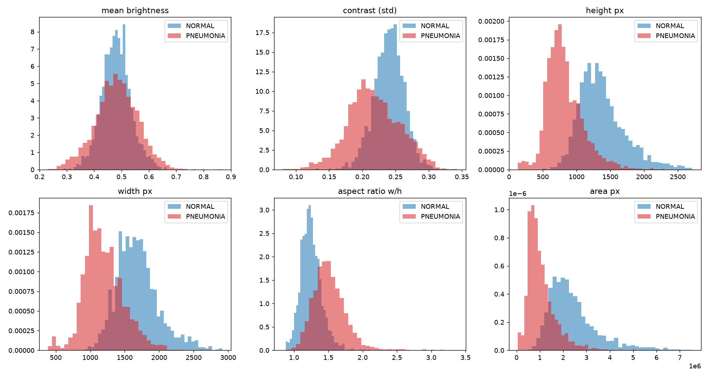
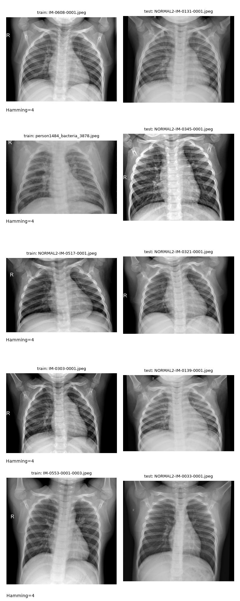
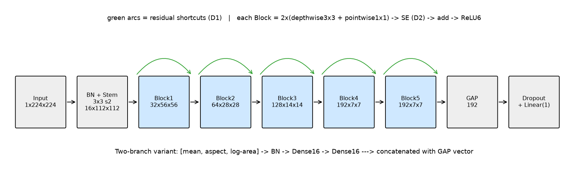
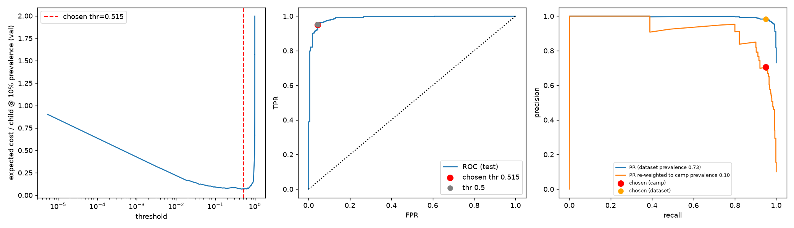
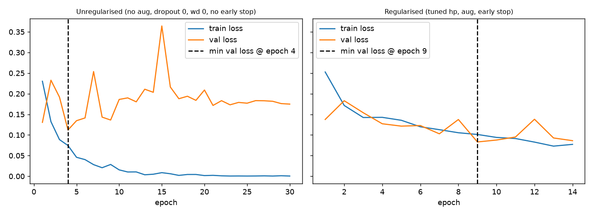
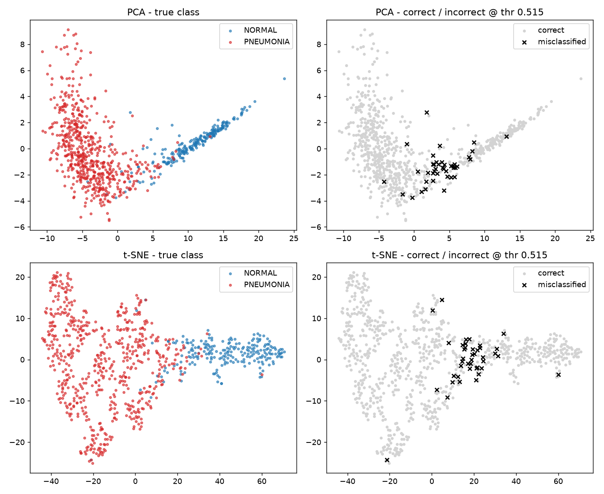
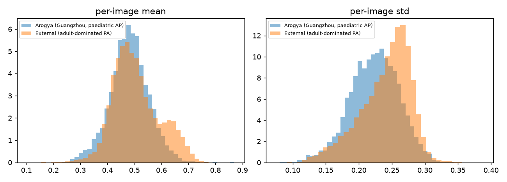

# MediScan Audit — Technical Report (target 5–7 pages once you add your prose; every table below is pulled in from results/)

## 0. Summary & the wrong instruction
WRITE ~10 lines: instruction 2 ("99% accuracy") is wrong; show the camp-prevalence arithmetic below.
{{include results/ceo_arithmetic.md}}

## 1. Audit of Rohit's data (Part 1, tasks 1–3)
{{include results/audit_summary.md}}
 
{{include results/split_summary.md}}

## 2. Shortcut hunt and baselines (tasks 4–5)
{{include results/shortcut_summary.md}}
{{include results/baselines_summary.md}}

## 3. Models (tasks 6–9)
{{include results/arch_table.md}}

Hypotheses (written before results): see hypotheses.md
{{include results/summary_runs.md}}

## 4. Imbalance, threshold, cost (Part 2.1)
{{include results/threshold_cost.md}}

## 5. Evaluation and cross-validation (2.2)
{{include results/cv_table.md}}

## 6. Tuning and regularisation (2.3)
{{include results/tuning.md}}

## 7. Ensembles (2.4)
{{include results/ensemble_summary.md}}

## 8. Feature space (2.5)
{{include results/embeddings_summary.md}}

## 9. External generalisation (2.6)
{{include results/external_summary.md}}

## 10. Deployment (2.7)
{{include results/deploy.md}}
{{include results/rejection_test.md}}

## 11. Reproducibility
`pip install -r requirements.txt && bash run_all.sh` — seeds logged in results/seed_log.txt; every number above comes from results/*.md.
